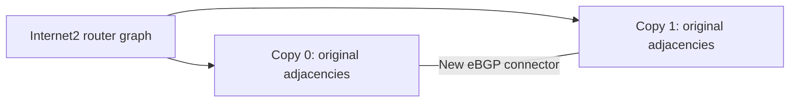

# Scaling networks

Separate the source snapshot, the topology representation, and the
routing profile. A larger graph does not by itself preserve routing
policy or create a larger routing problem.

## Published graph composition: REAL

REAL's pinned
[Batfish generator](https://github.com/XJTU-NetVerify/REAL-artifact-evaluation/blob/9186ddee0f2746cf6e4496416b0d13921be6f627/batfish/scripts/config/confgen.py)
contains `generate_blueprint_dupzoo` and `generate_blueprint_from_graph`.
The first function loads a Topology Zoo graph, creates copies with
distinct node IDs, and connects each new copy to the existing component
with one random edge. The second assigns router IDs, ASNs, link addresses,
and originated networks, then renders FRR configs.

The published artifact includes KDL and FCCN source graphs. For example,
from that repository's `batfish/` directory:

```bash
python3 scripts/config/confgen.py frr dupzoo Kdl:4
```

This is a topology composition followed by policy generation. It is not
an Internet2 configuration-preserving transform. The upstream connector
selection uses the module random generator without setting a seed in
that function. Save the produced blueprint to reproduce a particular run.
The method is referenced here; upstream code is not vendored.

## Internet2: an executable topology-derived workflow

The bundled seed comes from Expresso's pinned
[inferred interface topology](https://github.com/XJTU-NetVerify/Expresso/blob/e21604f39b5e3ec2d75634ce39a73a6aeab9be65/networks/internet2/topology.txt).
The source has ten routers and 108 undirected logical interface circuits.
The [extraction helper](../networks/internet2/build_graph.py) collapses
parallel circuits to nineteen router-to-router adjacencies. It preserves
node identifiers and records input hash and circuit counts.

```bash
python3 networks/internet2/build_graph.py \
  --input networks/internet2/upstream/topology.txt \
  --output networks/internet2/topology.json
python3 networks/internet2-expanded/generate.py \
  --base networks/internet2/topology.json \
  --copies 100 --join random --seed 0 \
  --output build/internet2-100
```

The second command applies a repository-authored composition algorithm
with REAL's one-connector-per-new-copy structure. Unlike the referenced
function, this implementation takes an explicit seed. A connector chooses
one router in the new copy and one router in an earlier copy.



Every copy has the original nineteen internal edges. Node names identify
the copy and base router. ASNs, router IDs, link addresses, and service
prefixes are newly allocated. The generator renders single-hop eBGP with
synthetic service /32 origins. It replaces the original IS-IS, iBGP,
prefix policy, and external advertisements. Original Juniper files stay
in [the source snapshot](../networks/internet2/snapshot/configs).

For connected random or chain composition with C copies:

```text
routers = 10*C
links = 19*C + C - 1
directed BGP endpoints = 2*links
service origins = routers*prefixes_per_node
```

| Copies | Routers | Links | Directed BGP endpoints |
|---:|---:|---:|---:|
| 1 | 10 | 19 | 38 |
| 10 | 100 | 199 | 398 |
| 100 | 1,000 | 1,999 | 3,998 |
| 1,000 | 10,000 | 19,999 | 39,998 |

Alternative `--join` values are `chain`, `ring`, and `disconnected`.
Chain and ring use `--gateway` to choose the base router for connectors.
Disconnected copies increase device count while retaining independent
route domains. Ring composition uses C connectors for C greater than two.

Every generated manifest records the base graph and generator hashes,
seed, composition parameters, copy-to-source map, addresses, ASNs,
connectors, and component count. Preserve that manifest with any benchmark.

## Configuration-preserving expansion

A transform that starts from raw configs needs an explicit mapping for
node names, router IDs, interface addresses, originated prefixes, ASNs,
and peer identities. Decide which external identities remain shared and
which are duplicated.

Update prefix lists, communities containing ASN values, AS-path regular
expressions, static next hops, route-reflector clusters, and external
advertisement inputs according to that mapping. Text substitution alone
does not establish that these references retain their meaning.

Add inter-copy routing policy explicitly. Reusing an ASN across copies
can change AS-loop rejection; putting copies into one AS can require new
iBGP reachability and peering. Tests should establish which base
properties are preserved within a copy and which new inter-copy paths
are intended.

This repository's Internet2 generator is topology-derived. A
configuration-preserving expansion should be contributed as a separate
recipe with its rewrite map and policy checks.

## Parameterized fabrics

For Freedome, vary campus, building, cluster, rack, aggregation, and spine
counts independently. Choose OSPF or eBGP inside each cluster. Both use
the published /16 export boundary. Local rack-prefix count is a separate
parameter from device count.

Record the selected model and the resulting counts. Scaling a workload
includes route visibility, candidate paths, policy work, and component
structure as well as the number of routers.
